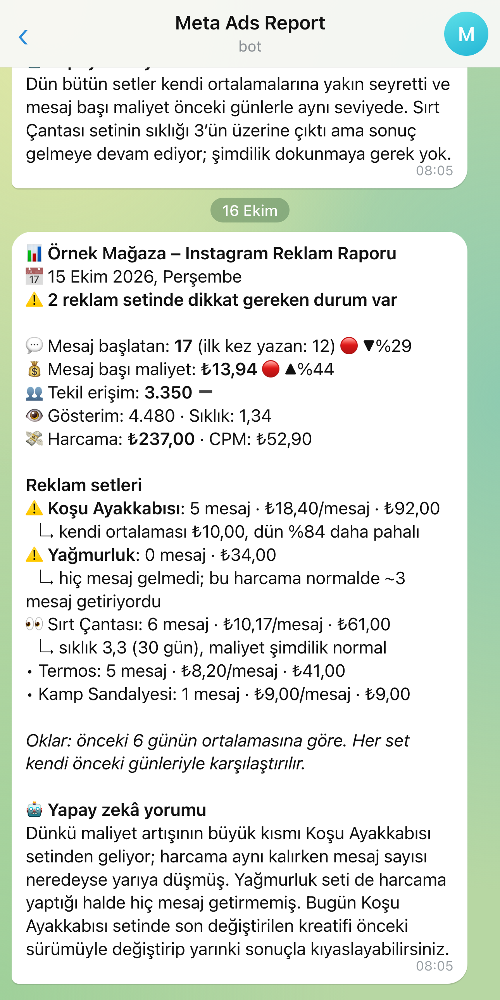

# n8n Meta Ads → Telegram daily report

An n8n workflow that sends yesterday's Meta (Facebook/Instagram) ad results to Telegram every morning at 08:00. Each ad set is compared with its own previous 6 days, and the ones that got more expensive or spent money without bringing messages are flagged at the top. Gemini adds a short comment.

Built for click-to-message campaigns (Instagram/Messenger/WhatsApp conversations). The report text and node names are in Turkish.

[Türkçe açıklama aşağıda](#türkçe)

*Example with a fictional store. The format is the same as the real report.*

## What's in the report

- **Account summary:** conversations started, cost per conversation, reach, impressions, frequency, spend, CPM. Each figure has an arrow against the average of the previous 6 days.
- **Ad sets:** each set is judged against its own history, not against other sets, because normal costs differ by product.
  - ⚠️ cost per conversation is 40% above the set's own average
  - ⚠️ the set spent money but got no messages
  - 👀 frequency is above 3 but cost is still normal (watch, don't touch)
- **AI comment:** 3 sentences from Gemini, focused on the most important alert. If Gemini fails, the report goes out without it.
- **Error alert:** if a step fails (for example an expired Meta token) you get one Telegram message a day saying which step and why.

## How it runs

The trigger wakes up every 5 minutes between 08:00 and 23:59. If today's report was already sent it stops right away; if not, it fetches the data and sends it. So if Meta doesn't respond at 08:00, the report still arrives a few minutes later.

## Setup

1. In n8n: **Workflows → Import from File** → `workflow.json`.
2. Create three credentials:
   - **Meta Ads Token** – *Query Auth*, name `access_token`, value: a Meta access token with `ads_read` permission (a System User token from Business Manager doesn't expire).
   - **Gemini API Key** – *Header Auth*, name `x-goog-api-key`, value: your key from Google AI Studio.
   - **Telegram account** – your bot token from @BotFather.
3. Open the **Ayarlar** (Settings) node and fill in:
   - `businessName`, `businessDescription` – used in the report title and the Gemini prompt
   - `adAccountId` – starts with `act_`
   - `telegramChatId` – the chat the bot will write to
4. Put the same chat ID into the **Hata Uyarısını Telegram'a Gönder** node too. The error branch runs separately and can't read the Settings node.
5. Activate the workflow.

The thresholds (`costIncreasePct`, `frequencyLimit`, `minSpend`, `minBaseConversations`, `frequencyWindow`) are in the same Settings node and explained in the sticky note on the canvas.

## More

How and why I built it: [omertataroglu.com/en/work/ziya-teknik-reklam-raporu](https://omertataroglu.com/en/work/ziya-teknik-reklam-raporu)

---

## Türkçe

Dünün Meta reklam sonuçlarını her sabah 08:00'de Telegram'a gönderen bir n8n akışı. Her reklam seti kendi önceki 6 günüyle kıyaslanıyor; pahalanan ya da mesaj getirmeden harcayan set en üstte işaretleniyor. Gemini kısa bir yorum ekliyor.

Mesaj reklamları için yapıldı. Raporun dili ve node isimleri Türkçe.

**Kurulum**

1. n8n'de **Import from File** ile `workflow.json` dosyasını içe aktarın.
2. Üç kimlik bilgisi oluşturun: **Meta Ads Token** (Query Auth, ad `access_token`, `ads_read` izinli token), **Gemini API Key** (Header Auth, ad `x-goog-api-key`) ve **Telegram account** (BotFather'dan bot token).
3. **Ayarlar** node'unda `businessName`, `businessDescription`, `adAccountId` (`act_` ile başlar) ve `telegramChatId` alanlarını doldurun.
4. Aynı chat ID'yi **Hata Uyarısını Telegram'a Gönder** node'una da yazın. Hata akışı ayrı çalıştığı için Ayarlar'ı okuyamıyor.
5. Akışı aktif edin.

Uyarı eşikleri de Ayarlar node'unda, açıklamaları akıştaki notta.

Nasıl yaptığımı anlattığım sayfa: [omertataroglu.com/isler/ziya-teknik-reklam-raporu](https://omertataroglu.com/isler/ziya-teknik-reklam-raporu)

## License

MIT
